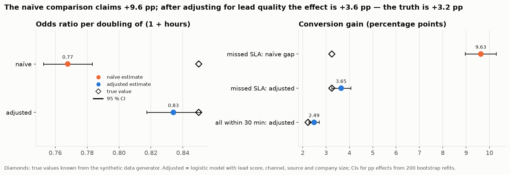
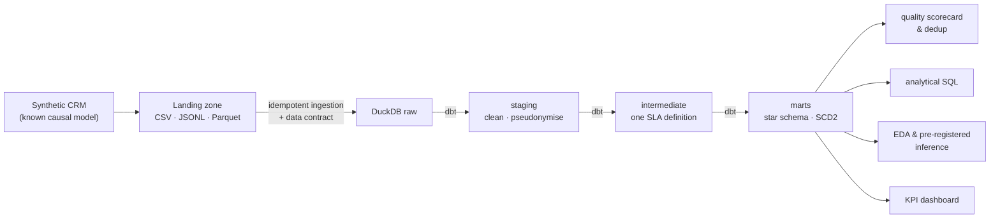
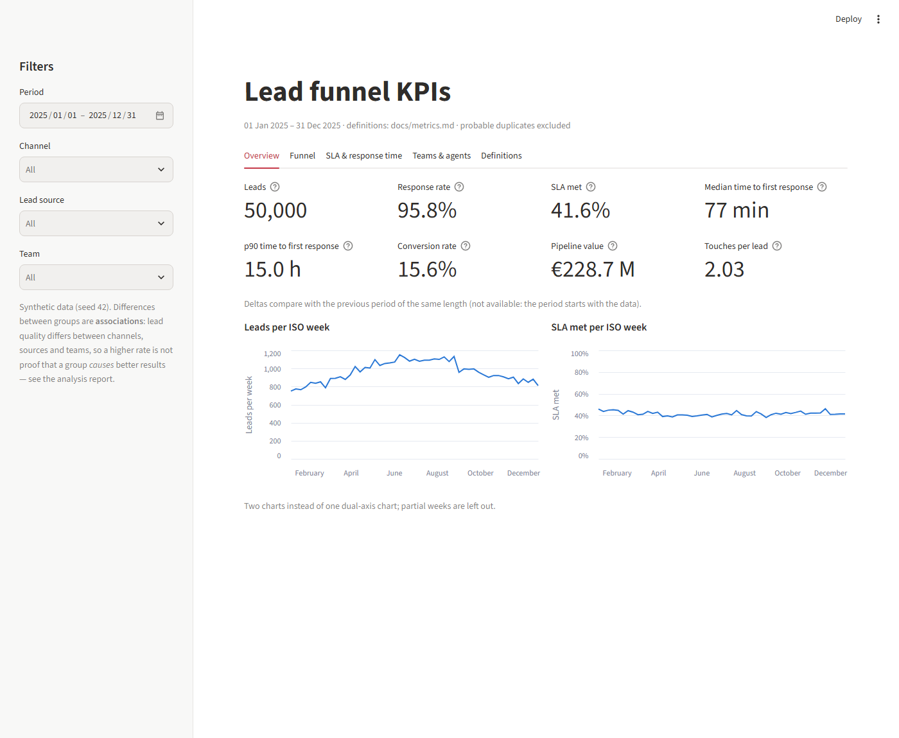

# Lead Funnel Analytics

> **Does answering leads faster really increase conversion — and by how much?**
> An end-to-end analytics case on a simulated CRM: data pipeline, tested star schema,
> pre-registered statistical inference and a KPI dashboard.

[](https://github.com/Andrielly-hsc/lead-funnel-analytics/actions/workflows/ci.yml)


[](LICENSE)

| Raw gap, SLA met vs missed | Real effect after adjustment | Value of answering every lead within 30 min |
|:---:|:---:|:---:|
| **+9.6 pp** conversion | **+3.6 pp** for leads that missed the SLA | **≈ 1 250** more opportunities a year (≈ €36 M pipeline) |



*The data is synthetic (50 000 leads, seed 42) — generated from a known causal model so that
every estimate can be checked against the truth. See [why](docs/adr/0004-synthetic-data-with-known-ground-truth.md).*

---

## Challenge

A customer-support organisation receives about 50 000 sales leads a year through web forms,
phone, e-mail and partners. Management suspects that **slow first responses cost
conversions** and is considering a 60-minute service level (SLA). But the CRM export is
messy — duplicate leads, inconsistent channel and country codes, missing company data,
clock errors — and nobody can say how much faster responses would actually be worth.

Three questions:

1. How does the funnel perform today, by channel, source, team and week?
2. Do leads answered within the SLA convert more — and is the difference real?
3. How much of that difference is **caused** by speed, and what would a faster-response
   policy deliver?

## Solution



| Step | What was built | Highlights |
|---|---|---|
| **Data** | Synthetic CRM generator ([F02](docs/features/F02-synthetic-crm-data-generator.md)) | Causal model with a confounder (lead quality); realistic defects injected and logged |
| **Ingestion** | DuckDB raw layer ([F03](docs/features/F03-ingestion-raw-layer.md)) | Idempotent by file hash, transactional, contract checks with quarantine, audit log |
| **Modelling** | dbt star schema ([F04](docs/features/F04-dimensional-model-dbt.md)) | SCD2 agent dimension with point-in-time joins, salted pseudonymisation, 120 data tests, reconciliation |
| **Quality** | Profiling & scorecard ([F05](docs/features/F05-data-quality-profiling.md)) | 6 quality dimensions on raw vs cleaned data; duplicate rule chosen by precision/recall |
| **SQL** | Analytical queries ([F06](docs/features/F06-analytical-sql.md)) | Window functions, cohorts, [9 silent SQL pitfalls with real numbers](docs/sql_pitfalls.md), [performance benchmark](docs/performance.md) |
| **EDA** | Tested EDA module + notebook ([F07](docs/features/F07-exploratory-analysis.md)) | Robust statistics, Wilson intervals, outliers vs errors, missingness mechanisms |
| **Inference** | Pre-registered analysis ([F08](docs/features/F08-statistical-inference.md)) | Plan committed before any code; naïve vs adjusted vs truth; 20-seed bias study |
| **Dashboard** | Streamlit on one metric layer ([F09](docs/features/F09-dashboard.md)) | Every KPI defined once, reconciled with SQL; CIs, small-n warnings, noise-aware deltas |

Engineering throughout: `pyproject.toml` + pinned lock file, ruff / sqlfluff / pre-commit, 177
tests, and a CI pipeline that regenerates the data, rebuilds the warehouse and re-runs every
query, report and notebook on each pull request. Design decisions are recorded as
[ADRs](docs/adr/) and every task's reasoning in its [task file](docs/tasks/).

## Result

**1. The raw comparison exaggerates the effect about threefold.** Leads answered within
60 minutes convert at 21.2 % vs 11.6 % (+9.6 pp, p < 10⁻¹⁸⁰). But agents answer promising
leads first, and promising leads convert anyway. After adjusting for lead quality, channel,
source and company size — the adjustment set from the [causal graph](docs/data/causal_dag.md) —
the effect is **+3.6 pp** (95 % CI 3.3-4.1) for leads that missed the SLA. The generator's
true value is +3.2 pp.

**2. The method is unbiased, and one dataset's interval can still miss.** Across 20
independent synthetic datasets the adjusted estimator's mean error is ≈ 0, with 90 % coverage
of the true coefficient — so the seed-42 interval narrowly missing the truth is the expected
1-in-20, not a flaw. ([seed study](reports/figures/inference_seed_study.png))

**3. The gain is concentrated outside business hours.** Inside Mon-Fri 08:00-18:00 the effect
drops to +1.9 pp; nobody works at night or at weekends, so those leads wait 14-60 hours and the
SLA is structurally 0 % for them. **Recommendation:** test evening/weekend on-call coverage
with an A/B experiment rather than push daytime speed — design and sample size in the
[analysis report](reports/analysis_report.md#6-recommendation-confirm-with-an-experiment).

**4. Data quality changes the numbers.** 500 near-duplicate leads (same person, new id) are
never contacted; removing them moves the response rate from 94.8 % to the true 95.8 %. A
fuzzy company-name match would have produced 6 304 false matches between *different* people — the duplicate rule uses
normalised e-mail or phone instead (precision and recall 1.0). ([quality scorecard](reports/quality/scorecard.md))



## Run it

Requirements: Python 3.11+, Git. About 15 minutes end to end on a laptop.

```bash
git clone https://github.com/Andrielly-hsc/lead-funnel-analytics.git
cd lead-funnel-analytics
py -3.11 -m venv .venv                        # macOS/Linux: python3.11 -m venv .venv
.venv\Scripts\activate                        # macOS/Linux: source .venv/bin/activate
pip install -r requirements-lock.txt
pip install -e . --no-deps

lead-funnel generate --seed 42                # 50 000 synthetic leads -> data/raw/
lead-funnel ingest                            # -> DuckDB raw layer (idempotent)
dbt deps  --project-dir dbt --profiles-dir dbt
dbt build --project-dir dbt --profiles-dir dbt   # star schema + 120 data tests
lead-funnel profile                           # quality profiles, scorecard, dedup analysis
python scripts/run_sql.py                     # analytical SQL -> reports/sql/
lead-funnel report                            # pre-registered inference (~6 min)
python scripts/run_notebooks.py               # EDA and inference notebooks
streamlit run src/lead_funnel/dashboard/app.py
pytest                                        # 177 tests
```

The same seed produces byte-identical data, so every number in this README is reproducible.

<details>
<summary>Windows: folder path with accents (e.g. <code>Portifólio</code>)</summary>

Python 3.11 on Windows reads the editable-install <code>.pth</code> file with the legacy code
page, so a non-ASCII folder path breaks <code>import lead_funnel</code>. Clone into an
ASCII-only path, or set <code>PYTHONUTF8=1</code> in your environment.
</details>

<details>
<summary>Updating dependencies</summary>

Edit the ranges in `pyproject.toml`, then regenerate the lock file:

```bash
pip-compile --extra dev --strip-extras --no-emit-index-url -o requirements-lock.txt pyproject.toml
```

On some networks this fails intermittently while building `dbt-core-experimental-parser`
(it downloads a binary from GitHub during the build); retrying works.
</details>

## Repository map

| Path | Contents |
|---|---|
| [`src/lead_funnel/`](src/lead_funnel/) | Python package: `generator/`, `ingestion/`, `quality/`, `analysis/`, `dashboard/`, CLI |
| [`dbt/`](dbt/) | dbt project: staging, intermediate, marts, tests, seeds, macros |
| [`sql/analysis/`](sql/analysis/) | Analytical SQL; results in [`reports/sql/`](reports/sql/) |
| [`notebooks/`](notebooks/) | Thin, executed notebooks: [EDA](notebooks/01_eda.ipynb), [inference](notebooks/02_inference.ipynb) |
| [`reports/`](reports/) | [Analysis plan](reports/analysis_plan.md), [results](reports/inference/results.md), [analysis report](reports/analysis_report.md), [quality](reports/quality/), figures |
| [`docs/`](docs/) | [Architecture](docs/ARCHITECTURE.md), [ADRs](docs/adr/), [backlog](docs/README.md), [data dictionary](docs/data/data_dictionary.md), [causal DAG](docs/data/causal_dag.md), [known issues](docs/data/known_issues.md), [data card](docs/data/data_card.md), [KPI definitions](docs/metrics.md), [lineage](docs/lineage.md) |
| [`tests/`](tests/) | Unit and integration tests |
| [`scripts/`](scripts/) | SQL runner, benchmark, notebook runner, lineage, dashboard check, BI export |
| [`powerbi/`](powerbi/) | DAX measures and guide for a Power BI version (deferred) |

## What I learned

- **Confounding is the default, not the exception.** In operational data the "treatment"
  (fast response) is chosen by people who see the outcome coming. Drawing the causal graph
  first decided which variables to adjust for — and which (follow-ups, meetings) must not be.
- **Pre-registration changes how you work.** Committing the plan before the code made every
  later change visible (three documented deviations) and kept me from choosing the convenient
  explanation when an interval narrowly missed the truth.
- **Tests catch what review misses.** A heatmap bug, a funnel step above 100 %, a separating
  logistic model, a `.gitignore` rule hiding a whole docs folder — each was found by a test, a
  reconciliation or the CI running on a clean machine, not by reading the code.
- **Data quality is a measurement, not a cleaning step.** Duplicates, missingness mechanisms
  and timestamp errors each moved a KPI; making them visible (scorecard, known-issues register)
  mattered more than removing them.

## License

[MIT](LICENSE)
