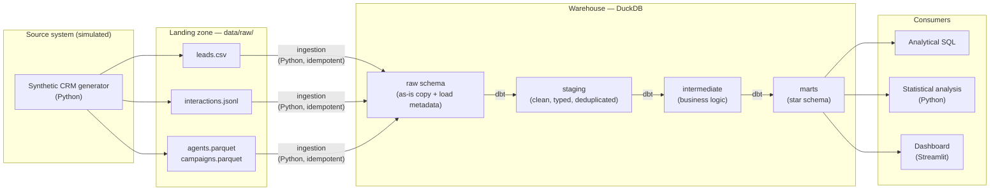
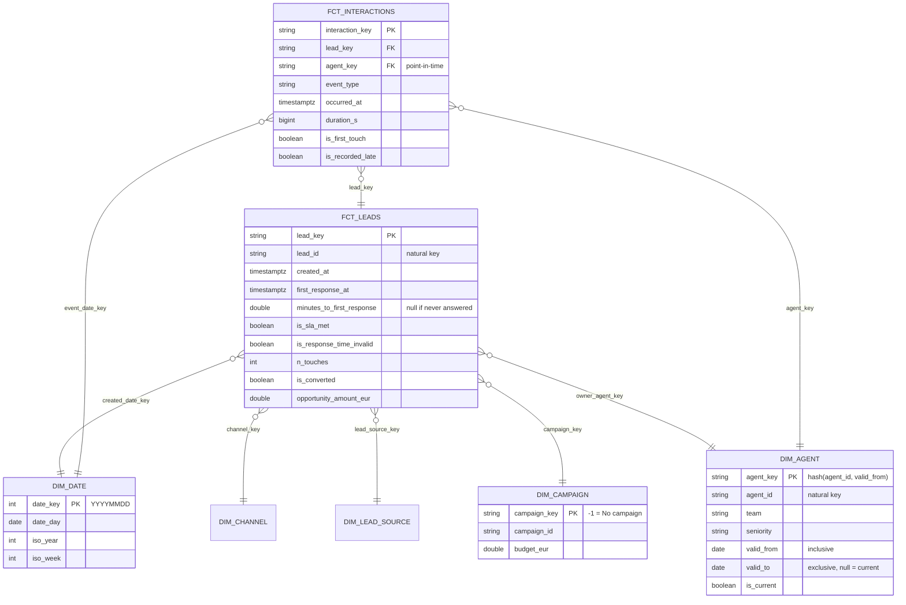
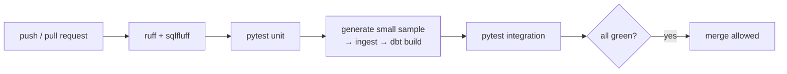

# Architecture — Lead Funnel Analytics

> **Status:** Draft v0.1 · **Owner:** project author · **Last review:** 2026-11-15
>
> This document is the single source of truth for *how* the project is built.
> Every feature and task in [`docs/features`](features/) and [`docs/tasks`](tasks/)
> must follow it. When a decision here changes, record it as an
> [Architecture Decision Record](adr/) first, then update this file.

---

## 1. Context and goals

### 1.1 Business problem

A customer-support organisation receives sales leads through several channels
(web form, phone, e-mail, partner referral). Management suspects that **slow
first responses are costing conversions**, but has no reliable reporting: data
lives in a CRM export with duplicates, missing values and inconsistent codes.

The project answers three questions:

1. **Descriptive** — How does the lead funnel perform (volume, conversion, time to first response, SLA compliance) by channel, source, team and period?
2. **Inferential** — Is the difference in conversion between leads answered within the SLA (≤ 1 h) and leads answered later statistically *and* practically significant?
3. **Causal (with care)** — After adjusting for confounders (lead quality, source, channel), how much of that difference can plausibly be attributed to response time?

### 1.2 Quality goals (non-functional requirements)

| Priority | Quality attribute | What it means here |
|---|---|---|
| 1 | **Reproducibility** | `git clone` → one command sequence → identical numbers, tables and figures. Fixed random seeds, pinned dependencies. |
| 2 | **Correctness / traceability** | Every KPI can be traced from dashboard → mart → staging → raw file (lineage). Data quality is tested, not assumed. |
| 3 | **Readability** | A reviewer at iSYS understands the repo in 5 minutes: clear layout, README as a case study, consistent naming. |
| 4 | **Statistical honesty** | Hypotheses are stated before testing, effect sizes and uncertainty are always reported, limitations are explicit. |
| 5 | **Low cost / portability** | Runs on a laptop, no cloud account, no paid licence. |

### 1.3 Constraints

- No real personal data. All data is **synthetic**, generated with a known ground truth (see [ADR-0004](adr/0004-synthetic-data-with-known-ground-truth.md)).
- Must run on Windows, macOS and Linux (CI runs on Linux).
- Python ≥ 3.11.

---

## 2. Solution overview

The project follows a **layered (medallion-style) analytics architecture**, the
same pattern used in modern data platforms such as Microsoft Fabric, Databricks
and Snowflake — just scaled down to a single file-based warehouse.



| Layer | Responsibility | Built with | Rule |
|---|---|---|---|
| **Landing** (`data/raw/`) | Files exactly as the source delivers them | Generator | Never edited by hand. Immutable once written. |
| **Raw** | Byte-for-byte copy in tables + `_loaded_at`, `_source_file`, `_file_hash` | Python ingestion | No transformations. Lets you re-run everything downstream. |
| **Staging** | One model per source table: rename, cast, standardise codes, deduplicate, pseudonymise | dbt | 1:1 with sources; only joins to mapping seeds. |
| **Intermediate** | Reusable business logic (e.g. first response per lead) | dbt | Not exposed to end users. |
| **Marts** | Star schema for analysis (facts + dimensions) | dbt | Documented, tested, stable column names. |
| **Consumers** | SQL analyses, statistics, dashboard | SQL, Python, Streamlit | Read **only** from marts. |

> **Why layers?** Each layer has one job, so a bug is easy to locate, and you
> can rebuild any layer from the one below it. This is the market-standard
> "ELT" pattern: **E**xtract and **L**oad raw data first, **T**ransform inside
> the warehouse.

---

## 3. Technology stack

| Concern | Choice | Why (market context) | ADR |
|---|---|---|---|
| Language | **Python 3.11** | Lingua franca of data science. | — |
| Packaging | **`pyproject.toml`** (PEP 621) + `src/` layout | The official Python standard since 2021; replaces `setup.py`. | — |
| Environment | **venv + pip**, pinned with `requirements-lock.txt` (pip-tools) | Ubiquitous, no extra install. `uv` is the faster modern alternative and can replace it later with the same files. | — |
| Warehouse | **DuckDB** | In-process OLAP database, columnar, full SQL with window functions, reads CSV/JSON/Parquet natively. Free and laptop-friendly. | [0002](adr/0002-duckdb-as-analytical-warehouse.md) |
| Transformations | **dbt Core + dbt-duckdb** | Industry standard for SQL transformations: version-controlled models, tests, docs and lineage. | [0003](adr/0003-dbt-for-transformations.md) |
| Data manipulation | **pandas**, **numpy** | Standard; DuckDB returns pandas DataFrames directly. | — |
| Statistics | **scipy.stats**, **statsmodels** | `statsmodels` gives regression tables with CIs and p-values in the format reviewers expect. | — |
| Visualisation | **matplotlib** + **seaborn** (static), **plotly** (dashboard) | Static figures for reports, interactive for the app. | — |
| Dashboard | **Streamlit** | Pure Python, anyone can run it from the repo. Power BI version optional. | [0005](adr/0005-streamlit-for-dashboard.md) |
| Testing | **pytest**, **pytest-cov**, dbt tests | Standard test runner; dbt tests cover data, pytest covers code. | — |
| Lint / format | **ruff** (Python), **sqlfluff** (SQL) | `ruff` replaces flake8 + isort + black in one fast tool. | — |
| Git hooks | **pre-commit** | Runs lint/format before every commit so CI rarely fails. | — |
| CI | **GitHub Actions** | Free for public repos, native to GitHub. | — |

---

## 4. Repository layout

```text
lead-funnel-analytics/
├── .github/
│   ├── workflows/ci.yml            # lint + tests + dbt build on every push/PR
│   └── pull_request_template.md
├── data/                           # ⚠ git-ignored (generated, reproducible)
│   ├── raw/                        # landing zone written by the generator
│   └── warehouse/lead_funnel.duckdb
├── dbt/                            # dbt project (transformations)
│   ├── dbt_project.yml
│   ├── profiles.yml                # uses env vars, no secrets
│   ├── models/
│   │   ├── staging/crm/            # stg_crm__leads.sql, _crm__sources.yml, _crm__models.yml
│   │   ├── intermediate/           # int_leads__first_response.sql
│   │   └── marts/                  # fct_leads.sql, dim_agent.sql, _marts__models.yml
│   ├── snapshots/                  # SCD type 2 history (dim_agent)
│   ├── tests/                      # singular (custom SQL) tests
│   ├── macros/
│   └── seeds/                      # small static CSVs (e.g. country code mapping)
├── docs/
│   ├── README.md                   # backlog index & board
│   ├── ARCHITECTURE.md             # this file
│   ├── adr/                        # architecture decision records
│   ├── features/                   # one file per feature
│   ├── tasks/                      # one file per task
│   └── templates/                  # feature/task/ADR templates
├── notebooks/                      # thin, numbered: 01_eda.ipynb, 02_inference.ipynb
├── reports/
│   ├── figures/                    # exported PNG/SVG
│   └── analysis_report.md
├── sql/analysis/                   # standalone analytical queries (KPIs, windows)
├── src/lead_funnel/                # the Python package
│   ├── __init__.py
│   ├── cli.py                      # `lead-funnel generate | ingest | profile | report`
│   ├── config.py                   # settings & paths (env vars)
│   ├── logging_setup.py
│   ├── generator/                  # synthetic data
│   ├── ingestion/                  # landing → raw
│   ├── quality/                    # profiling & scorecard
│   ├── analysis/                   # eda.py, inference.py, regression.py, viz.py
│   └── dashboard/app.py
├── tests/
│   ├── unit/
│   ├── integration/
│   └── conftest.py
├── .env.example
├── .gitignore
├── .pre-commit-config.yaml
├── .sqlfluff
├── CHANGELOG.md
├── LICENSE
├── pyproject.toml
├── requirements-lock.txt
└── README.md                       # the case study (Challenge → Solution → Result)
```

> **Why the `src/` layout?** It forces you to *install* the package
> (`pip install -e .`) before testing it, so tests run against the same code a
> user would get — not against whatever happens to be in the current folder.
> It's what the Python Packaging Authority recommends.

> **Why notebooks are "thin":** logic lives in `src/` (testable, reviewable in
> diffs); notebooks only *call* functions and show results. Notebooks with
> hundreds of lines of logic are the most common red flag in junior portfolios.

---

## 5. Data model

### 5.1 Source entities (synthetic CRM)

| Entity | File / format | Grain | Notes |
|---|---|---|---|
| `leads` | `leads.csv` | one row per lead (with injected duplicates) | created_at, channel, source, country, industry, company_size, lead_score |
| `interactions` | `interactions.jsonl` (JSON Lines) | one event per contact attempt | lead_id, agent_id, event_type, occurred_at, duration_s |
| `agents` | `agents.parquet` | one row per agent version | team changes over time → slowly changing dimension |
| `campaigns` | `campaigns.parquet` | one row per campaign | budget, start/end |
| `opportunities` | `opportunities.csv` | one row per converted lead | won_at, amount |

Using **CSV, JSON Lines and Parquet** on purpose: real integrations mix formats,
and each has different typing and parsing pitfalls.

### 5.2 Dimensional model (Kimball star schema)

As built in F04 (full lineage: [lineage.md](lineage.md); column documentation:
`dbt docs generate && dbt docs serve`).



**Modelling rules (Kimball):**

1. **Declare the grain first.** `fct_leads` = one row per *unique* lead
   (accumulating snapshot: milestones such as first response and conversion are
   columns). `fct_interactions` = one row per contact event (transaction fact).
2. **Surrogate keys** (`*_key`, hash of the natural key, plus validity for SCD2)
   generated with `dbt_utils.generate_surrogate_key`. Natural keys are kept for
   traceability.
3. **Conformed dimensions** — `dim_date` and `dim_agent` are shared by both facts.
4. **SCD Type 2** for `dim_agent`, built directly from the history in the HR export
   (a dbt snapshot would only be needed if the source overwrote history). Facts join
   to it **point-in-time** on the local event date.
5. **No null foreign keys:** a "No campaign" member (`'-1'`) instead of null.
6. **Facts hold numbers, dimensions hold descriptions.** No free text in facts;
   low-cardinality lead codes (country, size band) stay on `fct_leads`, because a
   `dim_lead` would be 1:1 with the fact.

---

## 6. Conventions and best practices by technology

### 6.1 Python

- **Style:** PEP 8, enforced by `ruff format` + `ruff check` (line length 100).
- **Type hints** on every public function; `from __future__ import annotations`.
- **Docstrings:** Google style, describing *what* and *why*, not *how*.
- **Functions are pure where possible** — take a DataFrame, return a new one; I/O at the edges (CLI, loaders).
- **No hard-coded paths or magic numbers**: paths come from `config.py`, parameters (seed, SLA minutes, alpha) from config/CLI arguments.
- **Errors:** raise specific exceptions (`ValueError`, custom `DataContractError`); never `except:` bare; never silence errors.
- **Logging, not `print`:** module-level `logger = logging.getLogger(__name__)`; one config in `logging_setup.py`.
- **Randomness:** always via `numpy.random.default_rng(seed)` passed explicitly — never the global `np.random.seed`.
- **Imports:** standard library → third party → local (ruff sorts them).

### 6.2 SQL and dbt (dbt Labs style guide)

| Rule | Example |
|---|---|
| Model prefixes by layer | `stg_crm__leads`, `int_leads__first_response`, `fct_leads`, `dim_agent` |
| Double underscore separates source and entity | `stg_<source>__<entity>` |
| lowercase `snake_case`, trailing commas, 4-space indent | enforced by `sqlfluff` |
| **CTE structure:** import CTEs → logical CTEs → `final` → `select * from final` | see below |
| Never hard-code table names | always `{{ ref('...') }}` / `{{ source('...') }}` |
| One model per file, YAML per folder | `_crm__models.yml` documents and tests models |
| Booleans prefixed `is_` / `has_`, timestamps suffixed `_at`, dates `_date` | `is_converted`, `created_at` |
| Every model has a primary key tested `unique` + `not_null` | in YAML |

```sql
-- models/staging/crm/stg_crm__leads.sql
with

source as (
    select * from {{ source('crm', 'leads') }}
),

renamed as (
    select
        cast(lead_id as varchar)            as lead_id,
        cast(created_at as timestamp)       as created_at,
        lower(trim(channel))                as channel,
        upper(nullif(trim(country), ''))    as country_code,
        cast(lead_score as integer)         as lead_score,
        _loaded_at
    from source
),

deduplicated as (
    select *
    from renamed
    qualify row_number() over (partition by lead_id order by _loaded_at desc) = 1
),

final as (
    select * from deduplicated
)

select * from final
```

**Materialisations:** staging = `view`, intermediate = `ephemeral` or `view`,
marts = `table`. Cheap to rebuild, fast to query.

### 6.3 Data quality

Quality is checked at three points (the "defence in depth" approach):

| Where | What | Tool |
|---|---|---|
| Ingestion | **Data contract**: expected columns, types, required fields. Bad files are quarantined, not loaded. | Python (`ingestion/contracts.py`) |
| Transformation | Generic tests (`unique`, `not_null`, `relationships`, `accepted_values`) + singular tests (e.g. response time ≥ 0) | dbt |
| Reporting | Scorecard across the 6 quality dimensions: completeness, uniqueness, validity, consistency, accuracy, timeliness | Python (`quality/scorecard.py`) |

Test severity: `error` blocks the pipeline, `warn` is reported. Known, accepted
issues are documented, not hidden.

### 6.4 Statistics and analysis

These are the analysis "house rules" — they are what separates a professional
analysis from a p-hacked one:

1. **Pre-register** hypotheses, metrics, α (= 0.05) and minimum effect of interest in `reports/analysis_plan.md` **before** looking at results.
2. Always report **effect size + confidence interval**, not only a p-value.
3. Distinguish **statistical** from **practical** significance (is +1 pp conversion worth the cost of faster staffing?).
4. **Check assumptions** (normality, equal variances, independence) and use a robust/non-parametric alternative when violated.
5. Correct for **multiple comparisons** (Holm or Benjamini–Hochberg) when testing many segments.
6. **Association ≠ causation.** Causal claims require a stated causal diagram (DAG), adjustment for confounders and an explicit limitations section.
7. Because the data is synthetic, compare every estimate with the **known true effect** to show the bias of naïve vs. adjusted methods.

### 6.5 Visualisation

- One message per chart; the title states the insight ("SLA-met leads convert 1.6× more"), not just the variable.
- Start bar charts at zero; label axes with units; show uncertainty (CI error bars/bands).
- Colour-blind-safe palette; same colour = same category across all charts.
- Export figures to `reports/figures/` as SVG/PNG at fixed size from code — never screenshots.

### 6.6 Git workflow

- **Trunk-based development:** `main` is always green; work on short-lived branches `feat/F02-T03-causal-effect`, `fix/...`, `docs/...`.
- **Conventional Commits:** `feat(generator): simulate response-time effect`, `test(ingestion): ...`, `docs: ...`. Enables automatic changelogs.
- One task ≈ one branch ≈ one Pull Request, with the task ID in the title.
- Never commit data, `.env`, the DuckDB file or notebook outputs with personal paths.
- **Semantic Versioning** for releases (`v1.0.0`) and a `CHANGELOG.md` (Keep a Changelog format).

### 6.7 Testing strategy (test pyramid)

| Level | Scope | Example | Run |
|---|---|---|---|
| Unit | one function | generator is deterministic for a given seed | `pytest tests/unit` |
| Data | one model | `fct_leads.lead_key` unique | `dbt test` |
| Integration | several components | generate → ingest → dbt build on a small sample, row counts reconcile | `pytest tests/integration` |

Target: ≥ 80 % line coverage on `src/`, 100 % of mart primary keys tested.

### 6.8 Configuration, security and privacy

- Settings from environment variables with defaults in `config.py`; `.env.example` documents them; real `.env` is git-ignored.
- No secrets exist in this project, but the pattern is the same one used in production (12-factor app).
- Synthetic data only. The generator still creates realistic PII-like fields (fake e-mail) to demonstrate **pseudonymisation** in staging (hashed e-mail, no raw e-mail in marts) — *data minimisation* as required by GDPR art. 5.

---

## 7. Runtime view (how to run)

```bash
py -3.11 -m venv .venv                  # Windows ("python3.11 -m venv .venv" on macOS/Linux)
.venv\Scripts\activate                  # Windows ("source .venv/bin/activate" on macOS/Linux)
pip install -r requirements-lock.txt
pip install -e .

lead-funnel generate --seed 42 --n-leads 50000   # → data/raw/
lead-funnel ingest                                # → raw schema
dbt build --project-dir dbt --profiles-dir dbt    # staging → marts + tests
lead-funnel profile                               # quality scorecard
lead-funnel report                                # figures + statistics
streamlit run src/lead_funnel/dashboard/app.py
```

Each step is **idempotent**: running it twice gives the same result, never duplicates.

---

## 8. CI/CD



CI uses a small dataset (`--n-leads 2000`) so it finishes in a few minutes.

---

## 9. Risks and technical debt

| Risk | Mitigation |
|---|---|
| Synthetic data looks "too clean" and unconvincing | Inject realistic issues (F02-T04); document the generating process openly. |
| Results depend on the generator's assumptions | State them; run sensitivity analysis with different effect sizes. |
| DuckDB is single-user | Fine for analytics on a laptop; the dbt models port to Postgres/Fabric with minimal changes. |
| Over-engineering a portfolio project | Every component must serve one of the 3 business questions. |

---

## 10. Glossary

| Term | Meaning |
|---|---|
| **Lead** | A potential customer who showed interest. |
| **First response time** | Minutes from lead creation to the first outbound contact by an agent. |
| **SLA** | Service Level Agreement — here, first response within 60 minutes. |
| **Conversion** | Lead becomes an opportunity (`is_converted = true`). |
| **Grain** | What one row of a table represents. |
| **SCD Type 2** | Slowly Changing Dimension that keeps history by adding a new row per change. |
| **Idempotent** | Running an operation multiple times has the same effect as running it once. |
| **Confounder** | A variable that influences both the cause and the effect, creating a spurious association. |
