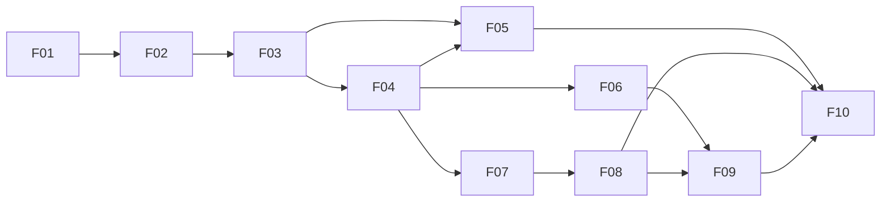

# Project documentation — Lead Funnel Analytics

This folder is the project's planning and design space. It follows a lightweight
**Kanban** workflow: every piece of work is a *feature* broken into *tasks*,
each in its own Markdown file, versioned with the code.

## Contents

| Path | What it is |
|---|---|
| [ARCHITECTURE.md](ARCHITECTURE.md) | How the system is built and the conventions every task follows |
| [adr/](adr/) | Architecture Decision Records — *why* key choices were made |
| [features/](features/) | One file per feature (goal, scope, acceptance criteria, task list) |
| [tasks/](tasks/) | One file per task (steps, acceptance criteria, deliverables) |
| [templates/](templates/) | Templates for new features, tasks and ADRs |

## Backlog

**10 features · 48 tasks · ~97 h estimated**

| ID | Feature | Priority | Depends on | Tasks | Estimate | Status |
|---|---|---|---|---|---|---|
| [F01](features/F01-project-setup.md) | Project setup & engineering standards | Must | — | 6 | 8 h | Done |
| [F02](features/F02-synthetic-crm-data-generator.md) | Synthetic CRM data generator | Must | F01 | 6 | 17 h | Done |
| [F03](features/F03-ingestion-raw-layer.md) | Ingestion into the raw layer | Must | F02 | 4 | 8 h | Done |
| [F04](features/F04-dimensional-model-dbt.md) | Dimensional model with dbt | Must | F03 | 6 | 13 h | Done |
| [F05](features/F05-data-quality-profiling.md) | Data quality & profiling | Must | F03, F04 | 4 | 10 h | Done |
| [F06](features/F06-analytical-sql.md) | Analytical SQL | Must | F04 | 4 | 8 h | Done |
| [F07](features/F07-exploratory-analysis.md) | Exploratory & descriptive analysis | Must | F04 | 4 | 7 h | Done |
| [F08](features/F08-statistical-inference.md) | Statistical inference & relationships | Must | F07 | 6 | 12 h | Done |
| [F09](features/F09-dashboard.md) | KPI dashboard | Should | F06, F08 | 4 | 8 h | Done |
| [F10](features/F10-case-study-and-release.md) | Case study documentation & release | Must | F05, F08, F09 | 4 | 6 h | In Progress |

### Feature dependency graph



## Workflow

```text
To Do  →  In Progress  →  In Review  →  Done
```

1. Pick the next task whose dependencies are **Done** (one task *In Progress* at a time — Kanban WIP limit = 1).
2. Set its `Status` to *In Progress* and create the branch named in the task file.
3. Implement; commit with [Conventional Commits](https://www.conventionalcommits.org/) (`feat(F02-T03): …`).
4. Open a Pull Request referencing the task ID; CI must be green.
5. Merge, set `Status` to *Done*, and write short notes in the task's *Notes* section.
6. When all tasks of a feature are done, check the feature's acceptance criteria and mark it *Done*.

### Definition of Ready (a task can start when…)

- Its dependencies are Done
- Steps and acceptance criteria are clear enough that someone else could do it

### Definition of Done (a task is finished when…)

- Acceptance criteria are met and checked
- Tests added/updated and passing; lint passing
- Docs updated where behaviour changed
- Merged to `main`

## Naming conventions

| Item | Pattern | Example |
|---|---|---|
| Feature file | `F<nn>-<slug>.md` | `F02-synthetic-crm-data-generator.md` |
| Task file | `F<nn>-T<nn>-<slug>.md` | `F02-T03-funnel-simulation.md` |
| ADR file | `<nnnn>-<slug>.md` | `0002-duckdb-as-analytical-warehouse.md` |
| Branch | `feat/F<nn>-T<nn>-<slug>` | `feat/F02-T03-funnel-simulation` |
