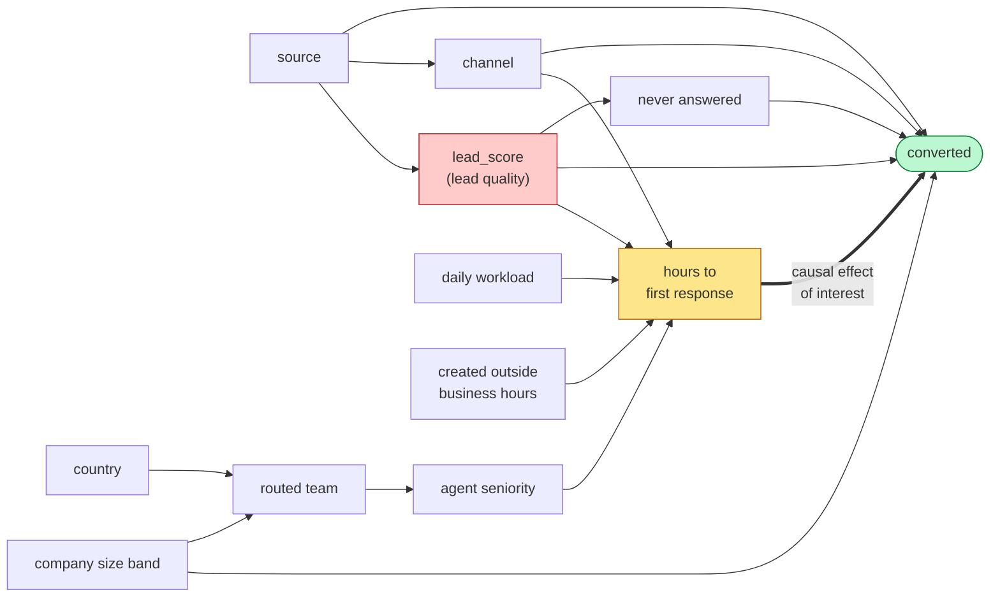

# Causal model of the synthetic CRM

> The generator simulates leads from the causal structure below. Because the
> structure and its parameters are **known**, the statistical analysis (F08) can be
> checked against the truth: a correct method must recover the true effect; a naïve
> one will be biased. Parameter values live in
> [`src/lead_funnel/generator/params.py`](../../src/lead_funnel/generator/params.py)
> and are written to `data/raw/_ground_truth.json` on every run.

## Directed acyclic graph (DAG)

## Why the naïve comparison is biased

`lead_score` is a **confounder**: it is a common cause of both the treatment
(response time) and the outcome (conversion).

- Agents prioritise high-score leads, so **good leads are answered faster**
  (`ResponseParams.beta_score = -0.35` on log-minutes).
- Good leads **convert more anyway** (`ConversionParams.beta_score = 0.90` on the logit).

A raw comparison "leads answered within the SLA vs. not" therefore mixes two
things: the real benefit of answering quickly *and* the fact that the quickly
answered leads were better to begin with. The naïve difference **overstates** the
true effect.

`source` and `channel` open further backdoor paths (`source → channel →
response time`, `source → conversion`) and must also be adjusted for.

## Adjustment set

To estimate the effect of response time on conversion, condition on
**`lead_score`, `channel`, `source`, `company size band`**. This blocks every
backdoor path. In plain language: compare leads that are alike in quality,
channel, source and company size, and differ only in how fast they were answered.

Variables that must **not** be needed for adjustment, and why:

| Variable | Role | Adjust? |
|---|---|---|
| agent seniority, daily workload, created outside business hours | Affect response time only (they behave like *instruments*) | Not needed; adjusting costs precision but does not bias |
| routed team | Caused by size and country; affects conversion only via response time | Not needed |
| number of follow-ups, meetings | Happen *after* the first response (mediators / consequences) | **No** — adjusting for them introduces bias |

## The true effects

| Quantity | True value | Where it comes from |
|---|---|---|
| Odds multiplier per doubling of (1 + hours to first response) | **0.85** (−15 %) | `ConversionParams.beta_log2_hours = ln(0.85)` |
| Effect of never answering a lead (logit) | **−2.50** | `ConversionParams.no_response_effect` |
| Policy effect: "every lead answered within 30 minutes" | computed per run | mean of counterfactual vs observed conversion probability, in `_ground_truth.json` |

The **policy effect** is the number a manager cares about: *how many more
conversions would we get if we answered every lead fast?* It is computed inside
the generator from each lead's true conversion probability under the observed
response time and under the counterfactual response time.

## Assumptions and simplifications

These are deliberate and must be stated in the final report:

1. The functional form of the effect (log2 of hours) is known to the analyst. Real
   data would require checking functional form (splines, binned response time).
2. There is **no unmeasured confounding**: everything that drives both response
   time and conversion is in the data. Real CRMs rarely guarantee this, and that is
   why an A/B test on routing is recommended in F08-T05.
3. Quality issues injected in F02-T04 (clock skew, late records) distort the
   *measured* response time but not the true one. They are measurement error on
   the treatment, which biases estimates towards zero. That is one more reason to
   clean data before inference.
