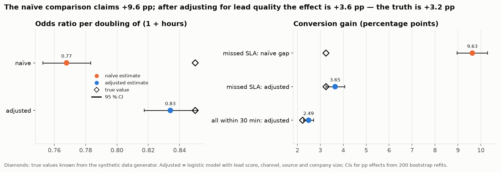
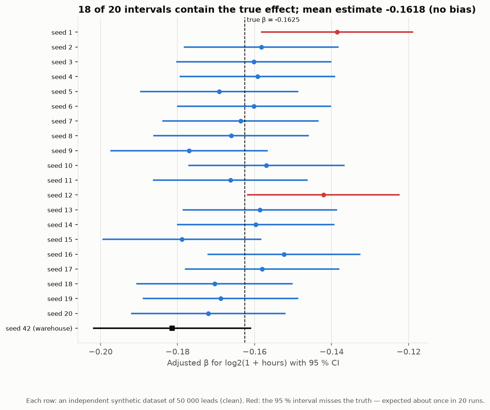

# Does faster first response increase lead conversion?

> **Status:** methods and causal discussion written in F08-T05. The executive summary is
> added in F10-T02. All numbers: seed 42, 50 000 leads (49 761 after the pre-registered
> exclusions); every one is reproducible from `notebooks/02_inference.ipynb` and
> `src/lead_funnel/analysis/`. Pre-registration: [`analysis_plan.md`](analysis_plan.md).

## 1. What the raw data says — and why it cannot be taken at face value

Leads answered within the 60-minute SLA convert at **21.2 %**, leads that are not at
**11.6 %**: a gap of **+9.6 pp** (95 % CI 9.0-10.3, p < 10⁻¹⁸⁰). Statistically this is beyond
doubt. *Causally* it is not, because the two groups are not comparable:

- agents answer **promising leads first** — high lead scores get faster responses
  (Spearman ρ = −0.18 between score and hours to response);
- promising leads **convert more anyway**, whatever the response time.

Lead quality is therefore a **confounder**: a common cause of the "treatment" (speed) and the
outcome (conversion). Part of the +9.6 pp is the quality of the leads that happen to be
answered fast, not the effect of answering fast.

## 2. The causal model and the adjustment set

The question "what does faster response *do* to conversion?" is answered by comparing leads
that are **alike in everything that drives both speed and conversion**, and differ only in how
fast they were answered. In the language of causal graphs: block every *backdoor path* from
response time to conversion (paths that start with an arrow *into* response time). Here that
means conditioning on **lead score, channel, source and company size** — the adjustment set.

Equally important is what must **not** be adjusted for: follow-ups and meetings happen *after*
the first response and are part of how speed works (mediators). Adjusting for them would
remove part of the very effect we want to measure.

## 3. Results after adjustment

| | Naïve | Adjusted (95 % CI) | Truth* |
|---|---|---|---|
| Odds ratio per doubling of (1 + hours) | 0.77 | **0.83** (0.82-0.85) | 0.85 |
| Conversion gain if leads that missed the SLA had been answered within 30 min | +9.6 pp (raw gap) | **+3.6 pp** (3.3-4.1) | +3.2 pp |
| Conversion gain if *every* lead were answered within 30 min | — | **+2.5 pp** (2.3-2.7) | +2.2 pp |

\* Known only because the data is synthetic (ADR-0004); used after estimating, never to choose
the model.

- **About two thirds of the naïve gap is confounding.** The adjusted effect is real,
  practically relevant (above the pre-registered +2 pp) and still large: each doubling of the
  waiting time lowers the odds of conversion by about 17 %.
- **Policy translation:** answering every lead within 30 minutes would add roughly
  **2.5 pp × 50 000 ≈ 1 250 opportunities a year** — about €36 M of additional pipeline at
  the average deal value of €29 k (pipeline, not revenue).
- **Model checks:** calibration within ±0.7 pp in every decile; the binned model shows the
  odds falling steadily with each later response band (1.00 / 0.90 / 0.59 / 0.42), supporting
  the log form; VIF ≤ 1.2 for the variables of interest.

### Do the intervals contain the truth?

The odds-ratio interval does. The two percentage-point intervals miss the truth **by 0.005 and
0.04 pp**. The pre-registered multi-seed study settles whether this is bias or chance: on 20
independent datasets the adjusted estimator's mean error is **+0.0007 ± 0.0023** on β and
**−0.02 ± 0.04 pp** on the effect, and its β interval covers the truth in **18 of 20** runs.
The estimator is unbiased; seed 42 is simply one of the datasets in which a 95 % interval
falls just short — which happens about once in twenty.

## 4. Robustness

| Variation (pre-registered) | Gain for missed-SLA leads | Holds? |
|---|---|---|
| Primary (SLA 60 min) | +3.6 pp | ✔ |
| SLA 30 min / 120 min | +2.9 / +4.7 pp | ✔ |
| 239 leads with corrupted response times included | +3.4 pp | ✔ |
| **Business hours only** | **+1.9 pp** | ✘ below +2 pp |
| 20 independent datasets | mean +3.25 pp (truth 3.27) | ✔ |
| 19 segment tests, Holm / BH corrected | all significant | ✔ |

The one failure is informative, not embarrassing: **inside business hours**, leads that miss
the SLA are usually answered within a few hours, so speeding them up gains less. Most of the
benefit comes from leads that currently wait **overnight or over the weekend** — which points
the recommendation at *coverage hours*, not at agents' daytime speed.

## 5. Alternative explanations and limitations

| Threat | Is it addressed? |
|---|---|
| **Confounding by lead quality** (agents prioritise good leads) | Yes — adjusted for the recorded lead score. |
| **Unmeasured confounding**: agents may sense urgency or budget that the score does not capture, and answer those leads first | **No.** Any such signal would make the adjusted effect too large. Synthetic data rules it out by construction; real data cannot. |
| **Reverse causality**: could likely-to-convert leads *cause* fast responses? | Partly the same as above — if agents can predict conversion beyond the score, the arrow runs both ways. |
| **Selection** (only leads registered in the CRM) | Results describe registered leads only (limitation L1). |
| **Measurement error** in response time (clock skew, wrong dates) | Errors excluded; including them changes the effect by 0.2 pp. |
| **Functional form** (log2 of hours assumed) | Supported by the binned model; real data would need splines. |
| **Representativeness / external validity**: one year, one organisation | Not addressed; seasonality and routing may differ elsewhere (L5). |

Statistical significance is not the issue here (power ≈ 1, plan §5); the issue is whether the
comparison is fair. Adjustment makes it fair *for the variables we observe*. It cannot make it
fair for the ones we do not.

## 6. Recommendation: confirm with an experiment

Observational adjustment is the best this data allows; an **experiment** is how to get causal
evidence that does not depend on having measured every confounder.

**Proposed A/B test — evening and weekend coverage**

- **Population:** leads created outside business hours (where the gain is concentrated).
- **Randomisation unit:** the lead (or the day, to avoid agents adapting within a shift).
- **Treatment:** routed to an on-call agent with a 30-minute target; **control:** current
  process (answered at the next opening).
- **Primary metric:** conversion to opportunity within 30 days; guardrails: deal value, agent
  workload.
- **Size:** about 5 400 leads per arm detect +2 pp with 80 % power (plan §5), i.e. ~10 900
  leads in total. Only ~11 300 leads a year arrive out of hours, so the test would take
  **about a year** at the current volume. Realistic options: target a larger, still
  worthwhile effect (+3 pp needs ~2 500 per arm, ≈ 5 months), or randomise by day across all
  channels' out-of-hours traffic as volume grows. Deciding this trade-off is part of the
  experiment design, not an afterthought.
- **Decision rule, fixed in advance:** roll out if the lower bound of the 95 % CI exceeds the
  cost-equivalent conversion gain of the on-call staffing.

Randomisation breaks the link between lead quality and response time by design, so the
experiment answers the question even if agents can read signals the CRM never records.
