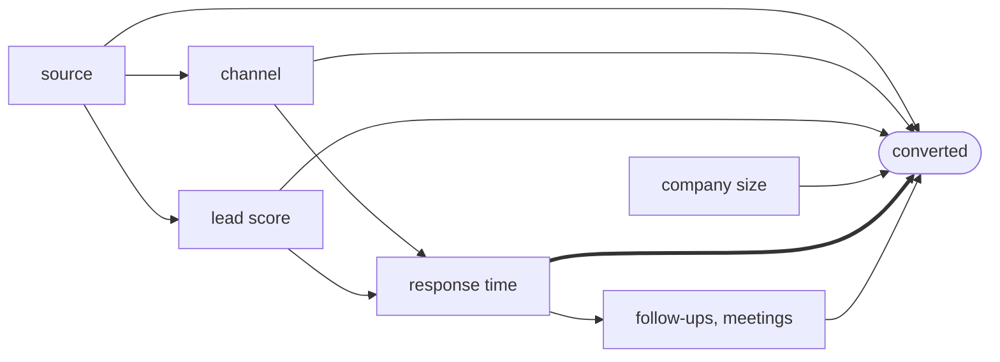

# Does faster first response increase lead conversion?

> Lead Funnel Analytics · v1.0.0 · Author: Andrielly-hsc · Data: synthetic CRM, seed 42,
> 50 000 leads in 2025 (49 761 after the pre-registered exclusions). Pre-registration:
> [`analysis_plan.md`](analysis_plan.md). Every number is traceable — see the table
> [*Where each number comes from*](#7-where-each-number-comes-from).

## Executive summary

**Question.** Management wants to know whether answering leads within 60 minutes increases
conversion, and what a faster-response policy would be worth.

**Answer.** Yes — but far less than the raw numbers suggest, and mostly for leads that
today wait overnight or over a weekend.

| Finding | Number | Confidence |
|---|---|---|
| Raw conversion gap, SLA met vs missed | +9.6 pp | High (statistically certain) — but **not** an effect |
| Share of that gap explained by lead quality (confounding) | about two thirds | High |
| Real gain for leads that missed the SLA, if answered within 30 min | **+3.6 pp** (95 % CI 3.3-4.1) | High for observed factors; unmeasured confounding possible |
| Gain if *every* lead were answered within 30 min | **+2.5 pp ≈ 1 250 opportunities ≈ €36 M pipeline a year** | Medium (depends on the policy actually reaching those leads) |
| Gain for business-hours leads only | +1.9 pp | Medium — below the +2 pp threshold of practical interest |

**Recommendations**

1. **Do not judge teams by the raw SLA-vs-conversion gap.** Two thirds of it reflects which
   leads they received, not how fast they were.
2. **Run an A/B test of evening and weekend on-call coverage** before investing: that is
   where the gain is concentrated and where the 60-minute SLA is currently impossible (0 %
   outside Mon-Fri 08:00-18:00). Design, metric and sample size in
   [§6](#6-recommendation-confirm-with-an-experiment).
3. **Clean the CRM before measuring.** Duplicate leads, clock errors and wrong import dates
   each moved a KPI; the data-quality rules in this project should run before every report.

**Limits.** Observational data: the adjustment covers lead score, channel, source and company
size, not signals agents may read that the CRM does not record (urgency, budget). Results
cover one year of one organisation. The data is synthetic, which is what allowed the
estimates to be checked against the true effects ([§3](#3-results-after-adjustment)).

---

## 1. What the raw data says — and why it cannot be taken at face value

Leads answered within the 60-minute SLA convert at **21.2 %**, leads that are not at
**11.6 %**: a gap of **+9.6 pp** (95 % CI 9.0-10.3, p < 10⁻¹⁸⁰). Statistically this is beyond
doubt. *Causally* it is not, because the two groups are not comparable:

- agents answer **promising leads first** — high lead scores get faster responses
  (Spearman ρ = −0.18 between score and hours to response);
- promising leads **convert more anyway**, whatever the response time.

Lead quality is therefore a **confounder**: a common cause of the "treatment" (speed) and the
outcome (conversion). Part of the +9.6 pp is the quality of the leads that happen to be
answered fast, not the effect of answering fast.

## 2. The causal model and the adjustment set

The question "what does faster response *do* to conversion?" is answered by comparing leads
that are **alike in everything that drives both speed and conversion**, and differ only in how
fast they were answered. In the language of causal graphs: block every *backdoor path* from
response time to conversion (paths that start with an arrow *into* response time). Here that
means conditioning on **lead score, channel, source and company size** — the adjustment set.

Equally important is what must **not** be adjusted for: follow-ups and meetings happen *after*
the first response and are part of how speed works (mediators). Adjusting for them would
remove part of the very effect we want to measure.

## 3. Results after adjustment

| | Naïve | Adjusted (95 % CI) | Truth* |
|---|---|---|---|
| Odds ratio per doubling of (1 + hours) | 0.77 | **0.83** (0.82-0.85) | 0.85 |
| Conversion gain if leads that missed the SLA had been answered within 30 min | +9.6 pp (raw gap) | **+3.6 pp** (3.3-4.1) | +3.2 pp |
| Conversion gain if *every* lead were answered within 30 min | — | **+2.5 pp** (2.3-2.7) | +2.2 pp |

\* Known only because the data is synthetic (ADR-0004); used after estimating, never to choose
the model.

- **About two thirds of the naïve gap is confounding.** The adjusted effect is real,
  practically relevant (above the pre-registered +2 pp) and still large: each doubling of the
  waiting time lowers the odds of conversion by about 17 %.
- **Policy translation:** answering every lead within 30 minutes would add roughly
  **2.5 pp × 50 000 ≈ 1 250 opportunities a year** — about €36 M of additional pipeline at
  the average deal value of €29 k (pipeline, not revenue).
- **Model checks:** calibration within ±0.7 pp in every decile; the binned model shows the
  odds falling steadily with each later response band (1.00 / 0.90 / 0.59 / 0.42), supporting
  the log form; VIF ≤ 1.2 for the variables of interest.

### Do the intervals contain the truth?

The odds-ratio interval does. The two percentage-point intervals miss the truth **by 0.005 and
0.04 pp**. The pre-registered multi-seed study settles whether this is bias or chance: on 20
independent datasets the adjusted estimator's mean error is **+0.0007 ± 0.0023** on β and
**−0.02 ± 0.04 pp** on the effect, and its β interval covers the truth in **18 of 20** runs.
The estimator is unbiased; seed 42 is simply one of the datasets in which a 95 % interval
falls just short — which happens about once in twenty.

## 4. Robustness

| Variation (pre-registered) | Gain for missed-SLA leads | Holds? |
|---|---|---|
| Primary (SLA 60 min) | +3.6 pp | ✔ |
| SLA 30 min / 120 min | +2.9 / +4.7 pp | ✔ |
| 239 leads with corrupted response times included | +3.4 pp | ✔ |
| **Business hours only** | **+1.9 pp** | ✘ below +2 pp |
| 20 independent datasets | mean +3.25 pp (truth 3.27) | ✔ |
| 19 segment tests, Holm / BH corrected | all significant | ✔ |

The one failure is informative, not embarrassing: **inside business hours**, leads that miss
the SLA are usually answered within a few hours, so speeding them up gains less. Most of the
benefit comes from leads that currently wait **overnight or over the weekend** — which points
the recommendation at *coverage hours*, not at agents' daytime speed.

## 5. Alternative explanations and limitations

| Threat | Is it addressed? |
|---|---|
| **Confounding by lead quality** (agents prioritise good leads) | Yes — adjusted for the recorded lead score. |
| **Unmeasured confounding**: agents may sense urgency or budget that the score does not capture, and answer those leads first | **No.** Any such signal would make the adjusted effect too large. Synthetic data rules it out by construction; real data cannot. |
| **Reverse causality**: could likely-to-convert leads *cause* fast responses? | Partly the same as above — if agents can predict conversion beyond the score, the arrow runs both ways. |
| **Selection** (only leads registered in the CRM) | Results describe registered leads only (limitation L1). |
| **Measurement error** in response time (clock skew, wrong dates) | Errors excluded; including them changes the effect by 0.2 pp. |
| **Functional form** (log2 of hours assumed) | Supported by the binned model; real data would need splines. |
| **Representativeness / external validity**: one year, one organisation | Not addressed; seasonality and routing may differ elsewhere (L5). |

Statistical significance is not the issue here (power ≈ 1, plan §5); the issue is whether the
comparison is fair. Adjustment makes it fair *for the variables we observe*. It cannot make it
fair for the ones we do not.

## 6. Recommendation: confirm with an experiment

Observational adjustment is the best this data allows; an **experiment** is how to get causal
evidence that does not depend on having measured every confounder.

**Proposed A/B test — evening and weekend coverage**

- **Population:** leads created outside business hours (where the gain is concentrated).
- **Randomisation unit:** the lead (or the day, to avoid agents adapting within a shift).
- **Treatment:** routed to an on-call agent with a 30-minute target; **control:** current
  process (answered at the next opening).
- **Primary metric:** conversion to opportunity within 30 days; guardrails: deal value, agent
  workload.
- **Size:** about 5 400 leads per arm detect +2 pp with 80 % power (plan §5), i.e. ~10 900
  leads in total. Only ~11 300 leads a year arrive out of hours, so the test would take
  **about a year** at the current volume. Realistic options: target a larger, still
  worthwhile effect (+3 pp needs ~2 500 per arm, ≈ 5 months), or randomise by day across all
  channels' out-of-hours traffic as volume grows. Deciding this trade-off is part of the
  experiment design, not an afterthought.
- **Decision rule, fixed in advance:** roll out if the lower bound of the 95 % CI exceeds the
  cost-equivalent conversion gain of the on-call staffing.

Randomisation breaks the link between lead quality and response time by design, so the
experiment answers the question even if agents can read signals the CRM never records.

## 7. Where each number comes from

| Number in this report | Source (re-run to reproduce) |
|---|---|
| 21.2 % vs 11.6 %, +9.6 pp, CI, p-value | `lead-funnel report` → [results § H1](inference/results.md#h1--conversion-sla-met-vs-missed-naïve-association); code `analysis/inference.py::sla_conversion_test` |
| Spearman −0.18 (score vs response time) | [results § Correlations](inference/results.md#correlations-answered-leads) |
| OR 0.83 (0.82-0.85), naïve 0.77 | [results § H3](inference/results.md#h3--response-time-and-conversion-naïve-vs-adjusted-logistic-model); `analysis/regression.py` |
| +3.6 pp, +2.5 pp and their CIs; truth +3.2 / +2.2 pp | [results § Comparison with the true effects](inference/results.md#comparison-with-the-true-effects-synthetic-data-only) (200 bootstrap refits) |
| 1 250 opportunities, €36 M | 2.49 pp × 50 000 leads; × average deal value €29 323 ([dashboard KPIs](../docs/metrics.md), `sql/analysis/01_funnel_kpis.sql`) |
| Calibration ±0.7 pp, binned ORs 1.00 / 0.90 / 0.59 / 0.42, VIF | [results § H3](inference/results.md#h3--response-time-and-conversion-naïve-vs-adjusted-logistic-model) |
| 20-seed bias study, 90 % coverage | [results § Bias check](inference/results.md#bias-check-on-20-independent-datasets); `analysis/robustness.py::seed_study` |
| Robustness table (+2.9 / +4.7 / +3.4 / +1.9 pp), 19 segment tests | [results § Sensitivity](inference/results.md#sensitivity-of-the-adjusted-analysis) and [§ Multiple testing](inference/results.md#multiple-testing--h1-within-19-segments) |
| SLA 0 % outside business hours | [`reports/sql/02_sla_compliance.md`](sql/02_sla_compliance.md) (Q3); [EDA notebook](../notebooks/01_eda.ipynb) §4 |
| Sample sizes for the experiment (5 429 / 2 468 per arm) | power calculation in [`analysis_plan.md` §5](analysis_plan.md#5-power-computed-from-the-overall-conversion-rate-only) |

All of it is regenerated by the pipeline in the [README](../README.md#run-it); the same seed
gives the same numbers.
