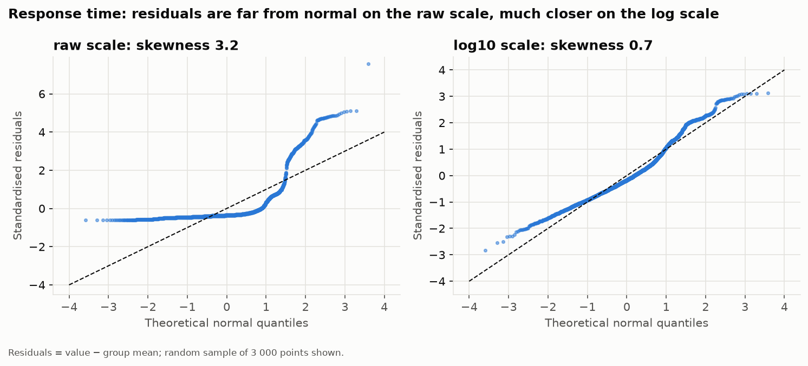
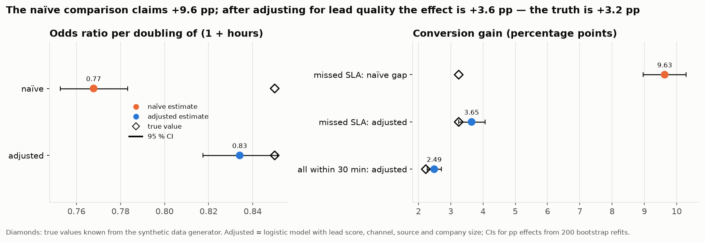
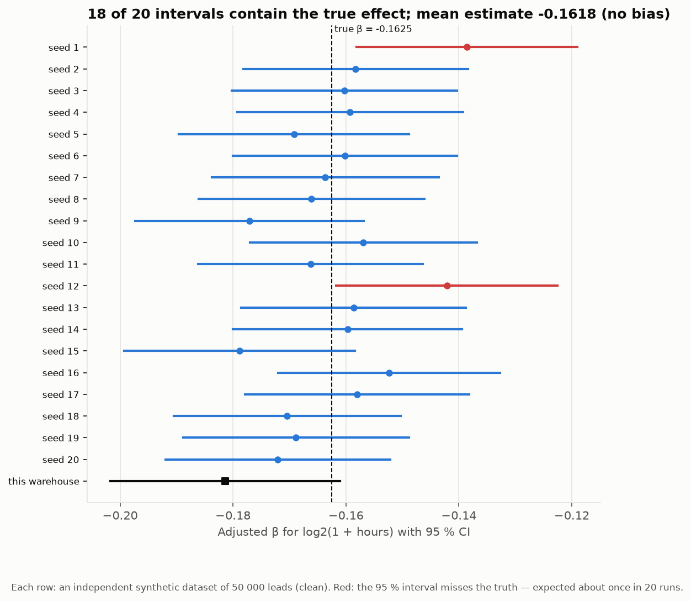

# Inference results

> Generated by `lead-funnel report` following the pre-registered [analysis plan](../analysis_plan.md). Interpretation: [analysis report](../analysis_report.md).

## H1 — conversion, SLA met vs missed (naïve association)

| comparison | n_met | n_missed | conv_met | conv_missed | diff_pp | diff_ci_pp | z | p_value | relative_risk | odds_ratio | cohens_h | practically_relevant |
|---|---|---|---|---|---|---|---|---|---|---|---|---|
| all leads | 20736 | 29025 | 0.2122 | 0.1159 | 9.6291 | [8.96, 10.30] | 29.1829 | 3.20e-187 | 1.8308 | 2.0546 | 0.2627 | True |
| business hours only | 20354 | 18136 | 0.2130 | 0.1167 | 9.6306 | [8.90, 10.36] | 25.2506 | 1.12e-140 | 1.8254 | 2.0488 | 0.2622 | True |
| answered leads only | 20736 | 26912 | 0.2122 | 0.1244 | 8.7786 | [8.10, 9.46] | 25.7455 | 3.62e-146 | 1.7056 | 1.8957 | 0.2365 | True |

## Correlations (answered leads)

| x | y | n | pearson_r | pearson_p | spearman_rho | spearman_p |
|---|---|---|---|---|---|---|
| lead_score | hours | 47648 | -0.0406 | 7.33e-19 | -0.1763 | 0.0000 |
| lead_score | n_touches | 47648 | 0.4187 | 0.0000 | 0.4114 | 0.0000 |
| hours | n_touches | 47648 | -0.0490 | 1.07e-26 | -0.1129 | 7.68e-135 |

## H2 — one-way ANOVA with assumption checks

| hypothesis | n | levene_p | min_shapiro_p | anova_F | anova_p | welch_F | welch_p | kruskal_p | eta_sq | omega_sq | test_used | reject_H0 |
|---|---|---|---|---|---|---|---|---|---|---|---|---|
| H2a log10(response hours) ~ channel | 47648 | 1.15e-189 | 2.22e-15 | 2,458.6239 | 0.0000 | 2,028.4420 | 0.0000 | 0.0000 | 0.1341 | 0.1340 | welch | True |
| H2b call duration ~ channel | 49087 | 0.3528 | 6.96e-24 | 0.9916 | 0.3955 | 1.0210 | 0.3821 | 0.6597 | 6.06e-05 | -5.13e-07 | classic | False |

## H3 — response time and conversion: naïve vs adjusted logistic model

| model | estimate | se | p_value | odds_ratio | ame_pp |
|---|---|---|---|---|---|
| naïve | -0.2642 | 0.0101 | 7.78e-150 | 0.7678 | ∅ |
| adjusted | -0.1814 | 0.0104 | 9.97e-69 | 0.8341 | -1.9970 |

Functional-form check (adjusted odds ratios by response-time band):

| response_bin | odds_ratio | ci_low | ci_high |
|---|---|---|---|
| ≤ 1 h | 1.000 | ∅ | ∅ |
| 1-4 h | 0.896 | 0.840 | 0.957 |
| 4-24 h | 0.588 | 0.540 | 0.640 |
| > 24 h | 0.419 | 0.366 | 0.478 |
| never answered | 0.051 | 0.031 | 0.084 |

Stratifying by lead-score quintile alone shrinks the gap from 9.6 pp (crude) to 5.5 pp:

| score_quintile | n | share_sla_met | conv_met | conv_missed | gap_pp |
|---|---|---|---|---|---|
| 1 | 10227 | 0.2803 | 0.0495 | 0.0265 | 2.3035 |
| 2 | 9828 | 0.3710 | 0.0858 | 0.0540 | 3.1820 |
| 3 | 10106 | 0.4169 | 0.1571 | 0.1023 | 5.4808 |
| 4 | 10467 | 0.4770 | 0.2249 | 0.1651 | 5.9771 |
| 5 | 9133 | 0.5493 | 0.4305 | 0.3226 | 10.7893 |

Calibration of the adjusted model (deciles of predicted probability):

| decile | n | predicted | observed |
|---|---|---|---|
| 0 | 4977 | 0.0113 | 0.0108 |
| 1 | 4976 | 0.0320 | 0.0305 |
| 2 | 4976 | 0.0511 | 0.0502 |
| 3 | 4976 | 0.0712 | 0.0643 |
| 4 | 4976 | 0.0944 | 0.1015 |
| 5 | 4976 | 0.1232 | 0.1222 |
| 6 | 4976 | 0.1615 | 0.1674 |
| 7 | 4976 | 0.2157 | 0.2189 |
| 8 | 4976 | 0.3016 | 0.2978 |
| 9 | 4976 | 0.4982 | 0.4966 |

## Multiple testing — H1 within 19 segments

| segment | value | n | diff_pp | p_value | p_holm | p_bh | sig_value | sig_holm | sig_bh |
|---|---|---|---|---|---|---|---|---|---|
| channel | email | 8950 | 11.2150 | 1.16e-38 | 1.62e-37 | 3.67e-38 | True | True | True |
| channel | partner_referral | 5358 | 15.2438 | 6.08e-31 | 5.47e-30 | 9.62e-31 | True | True | True |
| channel | phone | 10977 | 8.9708 | 3.80e-30 | 2.66e-29 | 5.56e-30 | True | True | True |
| channel | web_form | 24476 | 7.9250 | 8.43e-73 | 1.52e-71 | 8.01e-72 | True | True | True |
| lead_source | direct | 6018 | 9.8318 | 5.68e-24 | 2.84e-23 | 7.19e-24 | True | True | True |
| lead_source | event | 5049 | 11.2032 | 5.05e-22 | 2.02e-21 | 6.00e-22 | True | True | True |
| lead_source | organic_search | 14834 | 8.4987 | 4.09e-51 | 6.13e-50 | 1.55e-50 | True | True | True |
| lead_source | paid_search | 10878 | 7.5198 | 1.31e-35 | 1.57e-34 | 3.11e-35 | True | True | True |
| lead_source | partner | 5973 | 15.4500 | 1.61e-35 | 1.77e-34 | 3.40e-35 | True | True | True |
| lead_source | social | 7009 | 5.8088 | 1.86e-20 | 5.57e-20 | 2.07e-20 | True | True | True |
| team | enterprise | 1580 | 7.5602 | 3.67e-05 | 7.33e-05 | 3.87e-05 | True | True | True |
| team | inbound_dach | 32643 | 9.1257 | 3.23e-126 | 6.14e-125 | 6.14e-125 | True | True | True |
| team | inbound_international | 10180 | 8.5503 | 7.16e-37 | 9.31e-36 | 1.94e-36 | True | True | True |
| team | partner | 5358 | 15.2438 | 6.08e-31 | 5.47e-30 | 9.62e-31 | True | True | True |
| company_size_band | enterprise | 1536 | 8.0697 | 4.50e-05 | 7.33e-05 | 4.50e-05 | True | True | True |
| company_size_band | large | 7356 | 10.9561 | 5.67e-34 | 5.67e-33 | 1.08e-33 | True | True | True |
| company_size_band | medium | 18184 | 9.6488 | 7.55e-69 | 1.28e-67 | 4.78e-68 | True | True | True |
| company_size_band | small | 15789 | 9.2766 | 1.70e-58 | 2.72e-57 | 8.06e-58 | True | True | True |
| company_size_band | unknown | 6896 | 8.8770 | 3.56e-26 | 2.14e-25 | 4.83e-26 | True | True | True |

## Sensitivity of the adjusted analysis

| variant | n | naive_gap_pp | odds_ratio | or_ci_low | or_ci_high | effect_on_missed_pp | policy_lift_pp | robust |
|---|---|---|---|---|---|---|---|---|
| primary (SLA 60 min) | 49761 | 9.629 | 0.834 | 0.817 | 0.851 | 3.647 | 2.488 | True |
| SLA 30 min | 49761 | 9.899 | 0.834 | 0.817 | 0.851 | 2.903 | 2.488 | True |
| SLA 120 min | 49761 | 10.239 | 0.834 | 0.817 | 0.851 | 4.667 | 2.488 | True |
| errors included (239 leads) | 50000 | 9.557 | 0.844 | 0.828 | 0.861 | 3.446 | 2.366 | True |
| business hours only | 38490 | 9.631 | 0.845 | 0.804 | 0.888 | 1.892 | 1.351 | False |

## Comparison with the true effects (synthetic data only)

| label | estimate | ci_low | ci_high | truth | unit | truth_in_ci |
|---|---|---|---|---|---|---|
| naïve | 0.7678 | 0.7527 | 0.7832 | 0.8500 | odds ratio | False |
| adjusted | 0.8341 | 0.8174 | 0.8512 | 0.8500 | odds ratio | True |
| missed SLA: naïve gap | 9.6291 | 8.9634 | 10.2981 | 3.2474 | pp | False |
| missed SLA: adjusted | 3.6465 | 3.2526 | 4.0596 | 3.2474 | pp | False |
| all within 30 min: adjusted | 2.4884 | 2.2645 | 2.7134 | 2.2281 | pp | False |

Percentage-point CIs: percentile bootstrap, 200 refits (0 skipped for non-convergence).

## Bias check on 20 independent datasets

| quantity | mean_estimate | mean_truth | mean_error | se_of_mean_error | sd_across_seeds |
|---|---|---|---|---|---|
| beta | -0.1618 | -0.1625 | 0.0007 | 0.0023 | 0.0101 |
| effect_on_missed_pp | 3.2536 | 3.2689 | -0.0153 | 0.0396 | 0.1900 |
| policy_lift_pp | 2.2049 | 2.2148 | -0.0100 | 0.0220 | 0.1024 |

Coverage of the 95 % CI for β: **90%**.

