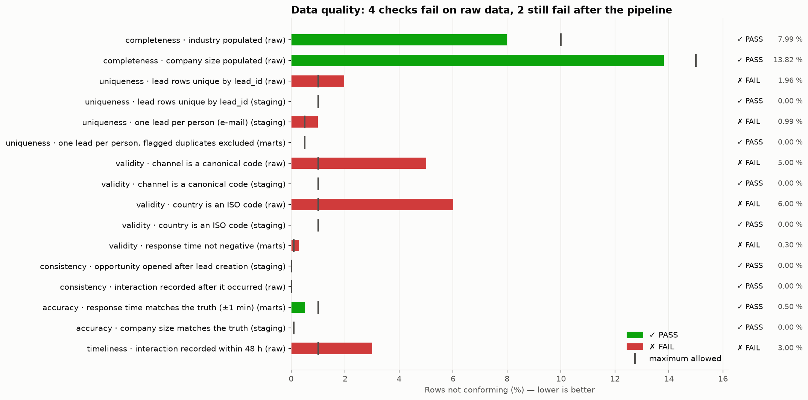

# Data-quality scorecard

> Generated by `lead-funnel profile`. Each metric is the share of conforming rows;
> **raw** = as delivered by the source, **staging/marts** = after the pipeline.
> Known, accepted issues and their handling: `docs/data/known_issues.md`.

| Dimension | Metric | Layer | Conforming | Value | Target | Status |
|---|---|---|---:|---:|---:|---|
| completeness | industry populated | raw | 47,393 / 51,510 | 92.01 % | ≥ 90 % | ✅ PASS |
| completeness | company size populated | raw | 44,392 / 51,510 | 86.18 % | ≥ 85 % | ✅ PASS |
| uniqueness | lead rows unique by lead_id | raw | 50,500 / 51,510 | 98.04 % | ≥ 99 % | ❌ FAIL |
| uniqueness | lead rows unique by lead_id | staging | 50,500 / 50,500 | 100.00 % | ≥ 99 % | ✅ PASS |
| uniqueness | one lead per person (e-mail) | staging | 50,000 / 50,500 | 99.01 % | ≥ 99.5 % | ❌ FAIL |
| uniqueness | one lead per person, flagged duplicates excluded | marts | 50,000 / 50,000 | 100.00 % | ≥ 99.5 % | ✅ PASS |
| validity | channel is a canonical code | raw | 48,932 / 51,510 | 95.00 % | ≥ 99 % | ❌ FAIL |
| validity | channel is a canonical code | staging | 50,500 / 50,500 | 100.00 % | ≥ 99 % | ✅ PASS |
| validity | country is an ISO code | raw | 48,417 / 51,510 | 94.00 % | ≥ 99 % | ❌ FAIL |
| validity | country is an ISO code | staging | 50,500 / 50,500 | 100.00 % | ≥ 99 % | ✅ PASS |
| validity | response time not negative | marts | 47,743 / 47,887 | 99.70 % | ≥ 99.9 % | ❌ FAIL |
| consistency | opportunity opened after lead creation | staging | 7,799 / 7,799 | 100.00 % | ≥ 100 % | ✅ PASS |
| consistency | interaction recorded after it occurred | raw | 101,734 / 101,734 | 100.00 % | ≥ 100 % | ✅ PASS |
| accuracy | response time matches the truth (±1 min) | marts | 47,648 / 47,887 | 99.50 % | ≥ 99 % | ✅ PASS |
| accuracy | company size matches the truth | staging | 43,083 / 43,083 | 100.00 % | ≥ 99.9 % | ✅ PASS |
| timeliness | interaction recorded within 48 h | raw | 98,682 / 101,734 | 97.00 % | ≥ 99 % | ❌ FAIL |

## Summary by dimension (metrics passing)

- **completeness:** 2/2
- **uniqueness:** 2/4
- **validity:** 2/5
- **consistency:** 2/2
- **accuracy:** 2/2
- **timeliness:** 0/1
